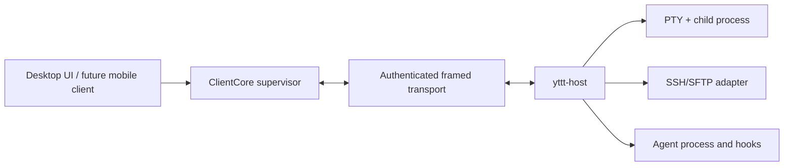

# yttt Host/Client 架构规范

- 状态：桌面既有 Host 远程访问已接入；平台与实际 UI 验收结果见实施计划
- 更新：2026-10-28
- 适用协议：`yttt-protocol` 资源 v22、lifecycle v3、desktop-shell v5；帧头 v1
- 相关设计：[`p2p-relay-architecture.md`](./p2p-relay-architecture.md)

本文定义 yttt 的标准 Host/Client 边界、资源所有权、终端同步协议、本地安全模型、生命周期和恢复语义。P2P、Relay、移动端等连接路径只能扩展本规范，不能改变资源所有权。

## 1. 不变量

1. Host 是长生命周期执行资源的权威节点；UI Client 只持有镜像和呈现状态。
2. 默认桌面 Host 由 desktop shell 的 authenticated owner channel 持有；关闭窗口不释放 owner，desktop shell 退出或连接消失必须 ForceStop Host 及其资源。
3. 只有显式启动的独立后台 Host 可在 Desktop Client 退出后继续运行；`--start-host` 与登录启动使用该模式。
4. 每个 profile 最多一个 Host；不同 profile、开发实例和测试实例使用不同 runtime root，不能串线。
5. 终端网格只在 Host 解析一次。Client 接收语义快照/增量，不重新解析原始 PTY 字节。
6. 一个终端同时只有一个 Interactive lease；Observer 可以只读附加。
7. 输入、尺寸、资源 revision、session epoch 和事件 sequence 都必须单调校验。
8. 慢 Client 不能阻塞 PTY reader、其他 Client 或 Host 资源循环。
9. 本地 IPC 仍须验证操作系统用户、endpoint 权限、profile、build 和一次性认证材料；“仅本机”不等于“可信”。
10. Wire 协议不序列化 Rust 进程内对象、GPUI Entity、PTY handle 或 SSH channel。
11. 同一 Host 的所有已认证 Client 会话都可写，不存在 profile 级单写者控制权。写入冲突由资源自身排序：布局按 Host revision，终端输入按 Interactive lease，文件编辑按每文档 lease。
12. 共享配置、工作区索引及可恢复草稿由 Host 权威持久化，本机 UI 也不能绕过 Host 写入。
13. 入口来源由 listener 指定；Client 自报 actor、通道或同 UID 不能把 TLS/SSH 工作入口升级为本机管理入口。

## 2. 部署拓扑



标准桌面部署包含两个 OS 进程：

- Desktop Client：GPUI window、focus、theme、render cache、编辑器呈现、命令面板和 `ClientCore`。
- `yttt-host`：PTY/child、终端 VTE 状态、scrollback、checkpoint、lease、资源目录和进程退出状态。

本地传输：

- Unix：profile runtime root 下的 Unix domain socket，目录权限 `0700`，socket 权限 `0600`，并验证 peer UID。
- Windows：拒绝远程客户端的 named pipe，DACL 仅允许 SYSTEM 和 owner。
- Wire：16-byte header、固定 magic/version/kind/length、最大 frame 32 MiB；header 在分配 payload 前验证。结构化消息使用带字段名的 CBOR；认证握手将连接固定为 session、lifecycle 或 desktop-owner 之一，连接建立后不得混用。一个已认证 Client 只有一条 session 连接，承载它的全部请求、响应、事件与终端帧。外层信封可识别但内容无法解析的请求得到 `Unsupported` 回复、响应转为对应请求的 `Unsupported`、事件被跳过，连接不断开。演进规则见 [`wire-evolution.md`](./wire-evolution.md)。

桌面 Host 可动态开启 TLS 1.3 TCP listener，默认关闭、初始地址 `127.0.0.1:43123`。
`ExistingHost` 只认证并附着此 Host，不启动第二个 Host 或桥接 daemon。导入证书按固定名称
进行标准验证，环境身份与转发地址分离；不启用 early data。证书、私钥和专用 TCP 秘密只在
主动启用时生成并存入设备私有状态，重置递增 credential generation 并撤销旧 TLS 通道。
本机管理 IPC、TLS 工作入口和独立 Server 的 SSH 工作 IPC 具有独立凭据和取消域。

## 3. crate 与责任边界

| 组件 | 责任 | 禁止持有 |
|---|---|---|
| `yttt-protocol` | ID、handshake 后 request/response/event、terminal snapshot/delta、SSH/file/git/agent wire DTO | socket、PTY、GPUI 类型、平台 handle |
| `yttt-transport` | 可靠双向 stream 抽象、framing、handshake、in-process 内存传输 | 具体 IPC/网络实现、Host 资源策略、UI 状态 |
| `yttt-transport-local` | Unix socket/named pipe endpoint、peer/permission 检查 | Host 资源策略、UI 状态、应用协议 |
| `yttt-transport-tls` | TLS 1.3 Connector、证书验证与持久证书支持 | GPUI、项目或终端权威状态 |
| `yttt-host` | 资源目录、terminal runtime、profile 控制屏障、工作区/配置存储、动态 TLS admission、drain | GPUI Entity、window/focus/theme |
| `yttt-client-core` | 连接 supervisor、请求关联、事件订阅、terminal mirror、重连对账 | PTY child、权威 scrollback、具体传输类型 |
| `yttt-terminal` | Host 侧 VTE/语义快照能力与 Client 侧 semantic render/input adapter | profile/Host 生命周期 |
| Desktop app | Host launch/attach、window lifecycle、Client mirror 到 `TerminalView` 的适配 | 长生命周期 PTY 所有权 |

依赖方向保持为：

```text
              yttt-protocol
                    ^
                    |
              yttt-transport
               ^          ^
               |          |
     yttt-client-core   yttt-host
               ^          ^
               |          |
        yttt-transport-local
                    ^
                    |
                 desktop
```

`yttt-client-core` 通过 `yttt-transport` 抽象连接各入口；Host 的动态网络管理使用
`yttt-transport-tls`，本机启动器负责绑定 `yttt-transport-local`。传输与 Host 均无 GUI 依赖。

`yttt-host` 与 `yttt-client-core` 不能依赖 Desktop UI。

## 4. 身份、认证与 profile 隔离

### 4.1 Host 身份

Host handshake 返回：

- `ProtocolRange`
- `build_id`
- `profile_id`
- `host_id`
- `host_epoch`
- 持久 `environment_id`、认证 session nonce 和 credential generation

`host_epoch` 每次 Host 进程启动递增。Client 的 session epoch、sequence 或 lease 不能跨 Host epoch 静默复用。

### 4.2 Client 身份

Client handshake 提交：

- 支持的协议区间
- `build_id`
- `profile_id`
- `client_instance_id`
- 已知 `host_epoch`（重连时）

连接必须满足协议相交、profile/environment 匹配和认证 token 验证；build 只用于诊断与 transcript，不参与兼容判断。本机管理入口还验证
OS peer；TLS/SSH 工作入口始终只有工作权限。完整握手 transcript 绑定环境、双方 nonce、通道、
资源、版本和权限请求。新 session 不能继承同名 actor 的请求日志或终端附着。

### 4.3 runtime root

每个 `AppProfile` 派生独立路径：

- endpoint
- `host.lock`
- `host.pid`
- `host-ready.json`
- `host-epoch`
- `auth-token`

开发 fixture 和测试必须使用隔离的临时 runtime root。不得扫描或回退到其他 profile 的 endpoint。

认证 token 文件在 Unix 上必须是普通文件、owner 正确且权限 `0600`；内存中的 token 在 drop 时清零。任何日志和 `Debug` 输出都不得包含 token 或 credential 明文。

## 5. 协议会话

### 5.1 帧

每帧包含 `magic`, `protocol_version`, `frame_kind`, `payload_len`。允许的 kind 为 handshake、
control、lifecycle 和 desktop-shell；session 连接只走 control kind，载荷是
`ControlMessage { Request, Response, Event, TerminalInput, Chunk }`。`FrameKind` 中旧的
terminal-interactive、state-event 数值保留不复用，Host 不再接受。解码顺序：

1. 读取固定 header。
2. 校验 magic、version、kind。
3. 检查 `payload_len <= 32 MiB`。
4. 分配并读取 payload。
5. 按 kind 反序列化。

任何边界失败都关闭该连接，不能影响其他 Client 或 Host 资源。

### 5.2 request/response

Client 为每个 request 分配单调 `request_id`。Host 原样回传该 ID。`ClientCore` 的普通与交互命令队列各最多保留 256 个在途请求，并回收已取消的等待者；尚未发送就过期的请求不会再执行。断线时未完成用户请求失败，不会假定执行成功并自动重放。请求超时只表示结果未确认，已经发送的操作仍可能完成。

Host 的普通控制请求使用最多 64 项的等待队列并按顺序执行；Ping、资源目录、Agent 快照和终端 checkpoint 可以在慢文件／Git 请求期间完成。这些恢复查询不进入 mutation journal。每次读取的 frame future 保留到完整读取或连接关闭，不能因其他请求完成而取消半帧。

这是 at-most-once Client 语义。调用方若在断线后重试有副作用操作，必须携带资源 ID、epoch/revision 或幂等键。

mutation 在 journal replay **之前**验证认证会话；journal 按 Client 会话隔离，新会话不能继承
已有会话的 journal 或终端。不存在 profile 级写入屏障：各资源自己串行化写入——布局在 workspace
锁内按 revision，终端输入与 resize 按 Interactive lease，文件草稿按文档 lease，终端启动按
`start_id` 与 `expected_host_epoch`。

`TerminalInput` 从 resource protocol v3 起使用 one-way message（`ControlMessage::TerminalInput`，
不携带控制上下文），不分配 `request_id`，也不产生逐按键 response。输入、resize、scroll
与心跳 Ping 在两端都走交互优先级：Host 读端把它们交给每连接的交互 worker 按到达顺序执行，
不排在项目、文件、Git、catalog 等慢请求之后；lease epoch、geometry epoch 和 `client_sequence`
仍在 Host 入口单调校验。Desktop 写入有界 interactive command queue 时同步得到
admission/backpressure；需要同步验证错误的诊断调用仍可显式发送 request/response 形式的
`Request::TerminalInput`。

### 5.3 server event

Host event 具有：

- `host_epoch`
- `host_sequence`
- event body

Client 必须按 epoch/sequence 处理，旧 epoch 或倒退事件不能覆盖新状态。终端自身另有 `session_epoch` 和 terminal `sequence`。

每个 Client 会话只有一条 session 连接。两端各有一个写任务独占写半边
（`yttt_transport::SessionWriter`），按优先级发送：

1. 交互：输入、resize、scroll、心跳 Ping 及其 response；队列 1,024 项。
2. 可靠：其余请求/响应、lease、exit、SSH、project、Agent snapshot、profile control 与 catalog
   invalidation；全局 FIFO，上限 1,024 项 / 32 MiB。
3. 渲染：每个已附加终端一个渲染 lane，Host 只在 lane 空闲时放入一帧，其余在渲染槽中合并；
   lane 之间轮转。

队列从不等待空间：超出上限即关闭连接，对端重连并对账。编码后超过 256 KiB 的消息拆为
`ControlMessage::Chunk` 序列，块之间可以插入交互帧，但可靠消息与渲染帧不互相穿插，
因此可靠顺序端到端成立；接收端（`SessionReader`）同时拼接至多 4 个 stream，总量不超过
32 MiB。可靠消息若关联终端 X（如 `TerminalExit`），写端先发完 X 的 lane 中已排队的帧，
所以最终帧一定先于退出事件到达。

订阅由请求表达：`SpawnTerminal` / `AttachTerminal` 成功即为该连接建立终端流，首帧是当前
snapshot；`DetachTerminal`、终止、退出确认与连接关闭释放它。Host 对同一
`client_instance_id` 至多保留一条 session 连接：同一认证会话的新连接替换并关闭旧连接，
其他认证会话被拒绝。

Client 的 session reader 是持续读取的独立 task；request enqueue、可见性上报或 catalog refresh
不能取消一个已部分读取的 frame，否则下一帧会从 payload 中间开始并被误判为
`invalid protocol magic`。

终端帧在 reader 中直接原位合并到 terminal mirror，只发布不可变的
`Arc<TerminalStreamUpdate>`；不得复制完整
`SemanticViewport`，也不得把同一 terminal frame 作为通用 `ClientEvent::Server` 重复广播。
Desktop 的 background receiver 只把这些 `Arc` 放进 per-terminal mailbox 并请求一次
coalesced redraw，绝不读取或锁住 GPUI render state。GPUI foreground 在下一次 mailbox drain
中用一个短锁按顺序应用该绘制帧积累的全部 delta，更新独立的 input-mode/scroll cache，然后
prepaint 只转换 damage row；未变化 row 的 render generation、text shaping 与 line identity
保持不变。title/process-state 与 lease/exit 等控制事件在 Host runtime worker 中按
`session_id` 过滤后才进入 GPUI，避免 continuously-ready 的 viewport 或无关事件消费者占用
前台 executor。
绘制阶段若 mailbox 的 redraw 标记再次置位，只请求下一 animation frame，不在当前 effects flush
中立即 defer/notify；必须让 foreground consumer 有机会消费已排队快照，避免重连时重复绘制饿死
状态更新和桌面控制请求。

## 6. 资源目录

`ListResources` 返回 `ResourceCatalog`：

- profile / Host identity
- catalog revision
- terminal placements
- SSH connection IDs

Terminal placement 只包含稳定 `project_id`、`session_id`、几何、owner、process state 和最后
sequence；不内嵌 `SemanticViewport`。`tab_id` / `pane_id` 只属于客户端布局，不进入 Host
catalog 或 `address_fingerprint`。viewport 只通过终端流的 initial snapshot 和后续
snapshot/delta 同步；attach 响应携带的 checkpoint 只在该终端尚无 mirror 时作为初始内容。

`AgentSnapshotUpdate.terminal_session_id` 是 Agent 状态关联当前客户端布局的唯一资源键。Client 必须先用它找到当前 terminal pane，再取得本地 `project_id/tab_id/pane_id`；Hook scope 中的 `tab_id` / `pane_id` 不是客户端布局键。若 pane 尚未恢复，Client 保留该 session 的最新 snapshot，待 placement 出现后再应用。
Desktop 的 Agent snapshot bridge 必须按 `terminal_session_id` 和 `(host_epoch, generation, sequence)` 合并最新值，不能让有界事件队列在 UI 暂停消费时静默丢失最终状态。Agent 进程存活但尚无权威 snapshot 只表示状态未知，UI 显示 `Stale`，不能推断为 `Working`。
事件桥发生 lag 时重放 Client 最新 Agent 缓存，补回安静 Agent 被挤掉的最终更新；重复或旧游标不覆盖新状态。
Host epoch 切换先清空 live Agent／项目计量缓存并发布 reset，再进入 Ready；Desktop 将旧 Agent 标为
失联，保留会话恢复信息，拒绝迟到的旧 epoch 快照。
Hook generation 直接使用实际 terminal `session_epoch`；退出事件必须同时匹配 session ID 和 epoch。
旧 PTY 延迟退出不能结束已经重开的 Agent，失败的 spawn 也只清理自身预备 hook scope。

连接成功或重连成功后，第一项资源对账请求是 `ListResources`。此后 Host 只发送
`ResourceCatalogChanged` invalidation；Client 合并重复通知并异步刷新一次 catalog。
只读 lifecycle 状态查询的连接关闭不发布资源目录变更；session 连接关闭释放终端 lease 时仍发布。
终端启动、重试与批量关闭另行读取权威 catalog，避免根据过期缓存决定创建或关闭的目标。
对账规则：

1. Host 在连接关闭时忘记该连接的终端流。重连后若 Host epoch 未变，Client 对自己已附加的每个
   session 发送 `RequestCheckpoint` 重新订阅（observer 身份，不抢 lease）；Host 发送的 initial
   snapshot 建立或替换 mirror。catalog 刷新不请求快照，也不改写现有 mirror。
2. 终端 sequence gap、epoch 变化或旧 Host 的 `ResyncRequired` 视为对端违约：Client 断开整条
   session 连接并重连，所有终端流以 Host 当前 snapshot 重新开流。Client 不请求 checkpoint 修补 mirror。
3. Client cache 中存在但 catalog 不存在时，删除 mirror 并发布 `TerminalUnavailable`。
4. UI 收到当前 pane 的 `TerminalUnavailable` 后结束旧 generation，等待 Host 目录再次列出该 pane 的终端后附加；Client 不重建进程。

对账完成前，旧 mirror 只是一份可见缓存，不是资源仍存活的证据。

### 6.1 多窗口与多 Client 写入

同一 Desktop Client 的 `SessionCoordinator` 为每个逻辑窗口分配独占的 `WorkspaceId` 视图。
本机和远程使用同一环境绑定与工作区恢复逻辑。窗口显式关闭以 `SetRestoreOnStartup` 清除
`restore_on_startup`；非空记录保留为历史，空记录自动回收。应用退出保留尚未关闭窗口的成员资格。
历史窗口必须通过 `OpenExisting` 读取，删除后不能因旧列表或重试隐式注册成空窗口。

任何已认证 Client 都直接写入，没有控制请求、交接或只读观察者状态；断线重连不冻结编辑，
也不重放排队 mutation。Session 连接握手后，Client 以一次 `Ping` 往返确认 Host 已把连接绑定到
本 Client 会话，之后才报告 Ready：以他人会话身份连接会在绑定时被 Host 关闭。

HostBootstrap 显式传入原 `config_root`，不根据 Server descriptor 猜路径。共享配置 RPC 只允许
已知配置文件与 `projects`、`themes`、`agent-providers` 子树，拒绝设备状态、密钥和 symlink 越界。
设备远程访问偏好与登录启动授权留在私有状态域；普通配置测试必须显式选择临时文件 backend，
生产绑定缺失不回退到本地文件系统。

Client 中用于呈现、拼接及回传的 Host 路径使用 `HostPath::to_client_path` /
`HostPath::from_client_path` 转换，不能调用要求当前操作系统格式的本机路径转换。
Windows Client 接收 Linux/macOS Host 路径时保留 `/` 根和正斜杠；在 Client 内拼接产生的
Windows 分隔符会在回传时重新拆为协议 segments，不附加本机盘符。该规则覆盖配置及 overlay、
目录浏览、项目注册、Agent 会话记录和文件草稿。本机文件访问及 desktop-shell 本机入口
继续使用 `HostPath::to_path` / `HostPath::from_path`，不得把远端路径当作本机路径访问。

每个 workspace 记录（schema 4，最大 24 MiB）保存 Host 布局、打开文档的草稿引用与 pane 的 Agent
状态引用。草稿正文每份最大 6 MiB、每 workspace 最大 64 MiB；Agent 状态正文每份最大 16 MiB、
每 workspace 最大 256 MiB。两者为内容寻址的对象，分别位于 `drafts/<workspace>` 与
`agent-states/<workspace>`。先持久化并验证正文，再替换引用它们的记录；记录写入成功后才回收
不再引用的旧正文，失败时回收新正文并保留旧记录。只允许读取当前 workspace 引用的对象。
启动回收未引用正文和已关闭的空记录；非空历史只由显式 `Forget` 删除。旧记录缺省不进入自动恢复集合。
`Forget` 和空记录自动回收确认后，同步重算项目工作区引用；不再引用的项目不能继续阻塞 Host 空闲退出。
持久 `workspace-history-initialized` 标记防止清空窗口后重新导入 legacy 状态；尚未初始化的 Host 仍可迁移旧数据。
schema 1–3 记录（Client 发布的不透明桌面快照）在启动时原子迁移为 schema 4：保留布局、文档草稿与
Agent 状态（含 revision、消息、任务与人工验收），不保留任何 lease；无法迁移的记录移到一旁，Host 照常启动。
本机自动恢复只消费 `restore_on_startup` 集合；关闭自动恢复或显式项目启动先归档未打开的旧成员。
显式远程连接读取 Host 当前窗口，不被本机的空白启动偏好屏蔽。历史恢复另开独占视图，不覆盖当前窗口。
Device 远程 Client registry 仅保存 SSH connection ID 或 Host credential ID，用进程锁避免重复启动；
连接凭据每次从安全存储重新解析。Host-key challenge listener 属于 Client 应用而非初始连接窗口。
PTY 丢失不删除 terminal/file tab、分组或布局。Client 只重建干净 shell 或恢复 Agent 会话，不重放任意命令。
pane `process_state`、`agent_snapshot` 及 Agent 状态引用由 Host 记录，Client 布局意图不会替换。

文档编辑按每文档 lease 排他。文档有未保存修改时，Client 以 `AcquireDocument` 取得 lease，
之后以 `PutDocumentDraft { epoch, revision, base, content }` 上传草稿；其他 Client 收到
`ServerEvent::DocumentChanged`，只读显示该草稿（`GetDocumentDraft`），可用 `takeover` 接管。
保存或丢弃后 `ReleaseDocument` 释放 lease 并删除草稿；过期 `epoch` 不改变任何状态，
lease 已转移时上传返回 `Conflict`。lease 属于 Client 会话：重连保留，会话过期或被接管时结束；
草稿随记录持久化，Host 重启后保留，lease 不保留。失去 lease 或文件被其他 Client 关闭时，
尚未上传的编辑写入本机 `document-copies/` 并提示用户，不再有 Device recovery 对账流程。

独立 `yttt-server` 的 descriptor 只导出 SSH `work.sock`/工作 token。status、stop-if-idle、
ensure 的管理连接仍使用另一个本机 socket/token；关闭桌面 TLS 不关闭 SSH 工作会话。

### 6.2 Host 布局与意图

Host 从每个 workspace 记录派生 `HostWorkspace` 布局。
`WorkspaceRequest::Apply { workspace_id, intent, expected_revision }` 由任意已认证 Client 发送；
Host 在 workspace 锁内按到达顺序执行，拒绝时状态与 revision 不变。不存在的 workspace 按空布局开始，
与 `Open` 所见一致，并受 workspace 数量上限约束。接受后：不再打开的文档及其草稿与 lease、
pane 已不存在的 Agent 状态随之移除，记录先持久化再发布，然后终止被移除 pane 的终端
（session ID 为 `{project}:{tab}:{pane}`）。

`Open`/`OpenExisting` 返回 `{ layout, documents, agent_states }` 并把当前 Session 连接订阅到该
workspace；每次布局变化后 Host 向所有订阅连接发 `ServerEvent::WorkspaceChanged`（完整布局）。每条连接每个
workspace 只保留一份未发出的布局：新布局占据旧布局在可靠队列中的位置，慢 Client 只收最新一份，
且布局仍在其后入队的 `TerminalExit` 之前到达。Client 只接受 revision 更大的布局；重连后对已打开的
workspace 重新 `OpenExisting`，Host epoch 变化时清空布局但保留已打开集合。

每次替换记录前，当前文件先复制到 `workspace-backups/<id>/backup-1.json`（依次后移，保留 3 份）；
至多每 15 分钟另存一份 `history-<millis>.json`（保留 48 份）。备份尽力而为，失败不阻止持久化。
启动时无法解析的记录先移为同目录的 `corrupt-<millis>.json`，再由最新可解析的备份（先轮转备份，
后历史副本）替换；没有可解析的副本时跳过该 workspace，Host 照常启动，损坏文件保留供人工恢复。
可解析但版本不受支持或迁移失败的记录仍使 Host 启动失败，避免以旧备份覆盖较新的数据。

## 7. 终端资源模型

### 7.0 pane 进程归 Host

布局 pane 的进程由 Host 决定何时运行，Client 只附加。Host 在每个被接受的意图之后、Client 打开
workspace 时、SSH 机器连接后，以及独立 Host 启动时执行同一个协调：已启动 tab 中 `Idle` 的 pane
启动；恢复时额外启动记录为 `Running` 而终端不在的 pane，以及带 Agent 会话的 `Exited` pane。
终端 ID 为 `{project}:{tab}:{pane}`。

- 启动输入：`settings.toml` 的 `[terminal]` `shell`（`auto` 取 Host 探测的首个 shell）、
  `environment` 与 `scrollback`，每次启动时读取；cwd 为 Host 登记的项目根；
  SSH 项目经项目描述的 `connection_id`。默认几何 120×40，首个 Interactive 附加按视口 resize。
- Agent pane：Host 首次启动 Agent 前安装托管 hook 与 OMP 扩展；按 provider 计划 resume 参数，
  本机 OMP 会话缺失时启动新 OMP。resume 未确认前保留旧会话，resume 失败保持退出而非循环重启。
  pane 的配置决定它是什么，保存的 Agent 快照只记录它运行过什么。Agent pane 只恢复属于自己 provider 的
  会话，其他 provider 的会话被丢弃（看板保留），pane 启动自己的命令。Shell pane 只恢复 Host 停止时仍在
  运行的 Agent，并在 shell 内恢复，Agent 退出后回到 shell；已自行结束、无法恢复或没有会话时起干净 shell。
  恢复出的快照表示进程已不存在，新进程上报前不算活动 Agent。Agent 身份只由
  `yttt_agent_providers::provider_for_command` / `provider_for_executable` 判定。
- 运行状态：每次启动尝试后发布 `ResourceCatalogChanged`，Client 刷新 catalog 后附加新终端。
  启动成功记 `Running`、退出记 `Exited`，推进 revision 并广播。退出行为 `Close` 由
  Host 关闭 pane，`AutoRestart` 500 ms 后重启，`ManualRestart` 保持退出；用户重启发
  `RestartPane { resume }`（`resume = false` 清除 Agent 会话）。Host 停止（drain 或 ForceStop）时自己
  结束的终端不记退出、不执行退出行为，pane 保持 `Running`，下次启动按恢复规则重建：shell pane 起干净
  shell，Agent pane 按会话 resume，command pane 不重跑而记为 `Exited`。
- Agent hook 报告按终端 ID 写入 pane 的 Agent 快照（保留看板），不推进 revision、不广播，
  持久化合并到每秒一次，`Open` 在返回前先写入。已结束（`Exited`）的快照作为历史留在 pane 上：侧栏、
  标签页与面板状态不把它算作活动 Agent，结束本身也不发通知。Host 停止时自己结束的 Agent 不记为
  `Exited`，因此保存的 `Exited` 表示 Agent 自行结束。
- 进程扫描已观测到 Agent 时，其他 provider 的根 session 事件被忽略：hook 环境会被子进程继承，
  由窗格内 Agent 启动的其他 Agent 不能替换窗格身份。
- 进程状态归 Host：Client 采用布局中的 `process_state`，只保留布局不携带的 Agent 快照。Host 丢弃
  pane 的 Agent 状态时向打开该 workspace 的 Client 发 `ServerEvent::AgentStateCleared`。

### 7.1 创建

`SpawnTerminal` 携带稳定的 `start_id`、`expected_host_epoch` 和完整的
`TerminalSpawnSpec`。重试同一次启动沿用标识；明确的新启动使用新标识。spec 包含：

- stable IDs
- cwd
- shell/command execution descriptor
- rows/cols/cell dimensions
- geometry epoch
- scrollback limit
- environment 与 removed-environment

Host 创建 PTY、spawn child、关闭 slave 副本，然后创建：

- 两个阻塞 I/O worker：PTY reader 与有界 writer
- Tokio terminal event task
- Tokio child monitor task
- `alacritty_terminal::Term`
- semantic snapshotter

Host 不保留原始 PTY 回放；`AttachTerminal.after_sequence` 与 `RequestCheckpoint.after_sequence`
仍在 wire 上但被忽略，`raw_replay_tail` 恒为空。

Client 不接收 PTY fd/handle。

#### 启动结果与关闭对账

Host 是终端生命周期的唯一权威。客户端不再维护 `OpenPending`/`Bound`/`ClosePending`
文件状态；工作区仍持久化布局和恢复意图，活跃资源以 Host catalog 为准。
旧 `terminal-placements.json` 不再读取、写入或自动删除，通用共享配置入口也不再允许访问它。

Host 在修改 Agent Hook 环境和创建进程前原子保留启动记录，使用原始
`(session_id, project_id, cwd, execution)` 的 SHA-256 识别地址。同标识不同地址被拒绝；
同标识仍对应存活资源时返回该资源，已清理或无法确认时返回 `OutcomeUnknown`，不能重新执行。
认证和 epoch 校验先于结果重放；Host 重启后旧 `expected_host_epoch` 必须被拒绝。

记录仅保留在当前 Host 内存，不承诺跨 Host 重启的 exactly-once。每个 Host epoch 最多保留
4,096 条记录，标识上限 256 字节；记录不保存原始命令参数，且不淘汰后重新接受旧标识。
达到上限返回 `ResourceLimit`，不会自动重启 Host 或终止正在运行的任务。

客户端收到通信失败或 `OutcomeUnknown` 后保留启动标识，显示 Reconciling/Retry 并读取
catalog；自动对账只在观察到对应资源时重新附加，不自动重发缺失资源的创建请求。
显式 Retry 仍沿用同一次启动标识。Host epoch 变化会终结旧尝试，不自动重放命令；
明确失败或退出后的新启动才分配新标识。Attach-only 恢复仍不能创建缺失的任意命令。

终止请求携带目标 `host_epoch` 和 `session_epoch`，先校验再操作资源；旧请求不能结束
同一 session ID 下的新一代进程。目标已不存在时幂等完成，仍存在时必须具有交互租约。
批量关闭按项返回结果；通信失败不再通过客户端文件把状态“回滚”为运行中。


### 7.2 输出路径

```text
child -> PTY master -> Host reader
      -> VTE parser -> authoritative Term
      -> SemanticSnapshotter
      -> snapshot or delta event
      -> ClientCore TerminalMirror
      -> TerminalView semantic viewport
      -> GPUI prepaint/render cache
```

Host 每次捕获生成完整 semantic viewport，再按上一序列构造 delta。delta 至少覆盖：

- changed rows/spans/style/hyperlink
- cursor
- modes/title/cwd
- palette revision
- process state
- geometry/scrollback epoch

Client 仅接受 `base_sequence == mirror.sequence` 的 delta；检测到 gap、epoch 变化或 `ResyncRequired` 后断开并重建整条 session 连接。

Host 的 VTE damage capture 最快每 4 ms 运行一次；每个终端流再按 16 ms
frame cadence 合并连续 delta，同一行只保留最新值。单个未合并 update 继续复用共享编码 frame；
sequence 不连续时不猜测状态，下一帧回退为当前 authoritative snapshot。

每个终端流只记录已交给写端的最后一帧元数据（发送基线：session epoch、sequence、
geometry/scrollback epoch、history size、display offset、modes、process state），不复制画面。
共享 delta 仅在 `base_sequence` 等于基线时入队，更旧的丢弃，其余改发当前 snapshot。
终端流持有一个只保留最新状态的渲染槽：新 delta 合并进槽，合并失败则改为需要 snapshot；
16 ms tick 时只有该终端的渲染 lane 空闲才交付槽内帧，因此每个 lane 至多一帧在途。慢 Client
期间槽持续合并、基线不前进，恢复读取后一次收到合并帧或一份 snapshot，不会出现 gap。
超过 512 KiB 的单帧（如大图片）只在 lane 为空时放入；Host 不发送 `ResyncRequired`。

#### 可见性

Client 用 `SetTerminalVisibility { revision, visible }` 上报本 Client 各窗口实际渲染的终端并集
（每个窗口每次渲染收集 terminal pane，集合变化才上报），Host 回复 `Applied` 并忽略不大于已记录
revision 的请求。从未上报的 Client（CLI、旧 Client）所有 attachment 均可见；Client 断开时记录清除，
重连后 ClientCore 重新上报当前集合；Host 回复 `Unsupported` 时本连接停止上报。

- 终端订阅数只计可见 attachment；全部不可见的终端与未附加终端一样跳过输出捕获，标题和退出仍触发捕获。
- 不可见 attachment 不发画面帧；标题、cwd、模式位或进程状态变化时发送只含元数据的 delta，
  使 tab 标题和退出状态保持更新。进程退出总是发送最终 snapshot。
- 不可见变为可见时发送一份当前 snapshot。
- CLI `panes read` 向 Host 请求当前 checkpoint，隐藏 pane 也返回最新内容。

Client 的 `TerminalView::new_semantic` 只启动一个 input writer worker；它不创建空转的 PTY reader/parser，也不分配本地 PTY read-buffer pool。这样 Host 化不会在 Client 重复 VTE 解析或额外保留两条空转线程。

Host terminal selection is ephemeral Client UI state, not Host resource state. `TerminalView` maps
mouse coordinates to semantic viewport rows, preserves endpoints through sequenced viewport updates
using stable `line_id` values, and derives highlight/copy text from the same spans. Soft-wrap
boundaries travel in semantic style flags so copied wrapped output omits synthetic newlines.
Selection never waits for a Host response and is discarded when geometry/scrollback epochs or
visible line identity make the endpoints ambiguous.

### 7.3 输入、resize 与 scroll

- `TerminalInput`：`client_sequence` 必须单调；Host 在写 PTY 前验证 Interactive lease。
- `ResizeTerminal`：`geometry_epoch` 必须递增；旧 resize 被拒绝。
- `ScrollTerminal`：请求绝对 `display_offset`；Host 将其转换为当前 authoritative grid 的受限 delta，并返回实际 offset。
  滚动条拖动以指针位置计算绝对目标；Host 尚未确认上次请求时，增量换算使用待确认目标，而非旧视口偏移。
- palette query：Client 发送当前可见主题 RGB 和 revision，Host 才能正确回答 OSC color query。

UI 不得在 GPUI 线程等待 Host response。输入经有界 writer queue；resize/scroll 发出异步请求。GPUI 的 render/layout/prepaint 热路径也不得执行 shell PATH 探测或其他文件系统 I/O；shell 候选在 Workbench 初始化时探测一次，后续 terminal 创建和设置 UI 只读取缓存。

已有 attachment 的按需 checkpoint、重复 attach、重连后的重新订阅及退出快照按其
`display_offset` 投影视口；未附着客户端的初始 checkpoint 使用底部。attachment 的 `display_offset`
任意变化都由终端流发送对应偏移的 snapshot，Client 不把 `TerminalScrolled` /
`TerminalViewport` 响应写入 mirror。历史视口暂停实时数据推送，显式回底后才恢复实时输出。

### 7.4 lease

- `Interactive`：可输入、resize、scroll；每个 terminal 唯一 owner。
- `Observer`：只读附加。
- acquire 新 Interactive lease 时，Host 撤销旧 lease，并向旧 owner 发送 `TerminalLeaseRevoked`。
- Client 断线只释放该 Client 的 lease，不终止 terminal。

### 7.5 退出

PTY child 退出后：

1. Host drain PTY 尾部、记录 `Exited { code }` 并发布带 final sequence 的最后 viewport。
2. 每个仍附加该终端的 session 连接：先排空它的渲染 lane 并发出最终 snapshot，再以
   终端屏障发送 `TerminalExit { session_id, session_epoch, code, final_sequence }`，所以最终帧总在
   退出事件之前到达，Client 不需要暂存。`TerminateTerminal` 的发起连接在响应后即结束该终端流，
   最终 sequence 以 `TerminalTerminated.final_sequence` 为准，不保证再收到 `TerminalExit`。
3. 资源及 final checkpoint 保持可查询，直到 owner 发送 `AcknowledgeTerminalExit` 或 10 分钟 TTL 到期。
4. acknowledgement 同时匹配 session epoch 和 final sequence 后，Host 才从 catalog 删除 terminal。

重复/旧 generation 的退出回调不得关闭新建 pane。

## 8. 背压与资源上限

固定边界：

| 边界 | 上限 |
|---|---:|
| wire frame | 32 MiB |
| Host terminal writer queue | 1024 commands |
| Host terminal internal event queue | 256 events |
| Host terminal subscriber channel | 64 events / subscriber |
| Client 普通命令队列 | 256 commands |
| Client 交互命令队列 | 256 commands |
| session 写端交互队列 | 1024 messages |
| session 写端可靠队列 | 1024 messages / 32 MiB |
| session 渲染 lane | 每终端 1 帧在途 |
| session 分块 | 256 KiB / chunk，接收端 4 个 stream、共 32 MiB |
| Desktop semantic update mailbox | 64 updates / terminal |
| Client event broadcast | 256 events |
| request timeout | 10 s |
| initial connect timeout | 10 s |

策略：

- Git 与远程命令走结构化操作，不再透传自由 argv；`git -c` / `-C` / `--exec-path` 等注入在 Host 侧被拒绝。特权远程命令默认关闭。
- `ClientRequest` 携带 `actor_device_id` 与可选 `lease_epoch`。本地 profile 在每个 mutating 入口检查 capability（当前恒真），并写审计条目；凭据挑战只发给 SSH 连接发起方。
- semantic event lag 不能阻塞 Host parser；lag 的 attachment 下一帧改发 snapshot。
- terminal input command 在 writer queue 中按 64 KiB 上限合并相邻 `Bytes` slice，不复制
  payload；输入队列满时明确返回 backpressure，不静默丢输入。
- 未完成请求、event receiver、terminal subscriber 和 semantic update mailbox 都必须有确定上限。

Host semantic capture 读取 Alacritty 自上次 publish 以来的 damage rows；常规 echo 只扫描并
编码实际变化的行。geometry、alternate-screen 或 history 边界变化才回退到完整 viewport。
主要性能成本因此是 Host 一次 VTE parse、damage-row semantic encode 和 Client 可见行
shaping/paint。空闲 terminal 不做轮询渲染；只有事件、光标闪烁或用户交互唤醒 UI。
异步 mailbox consumer 更新 terminal entity 后，会把 owning window 的 refresh 延迟到当前
draw 结束之后；这样在 frame 提交期间到达的最后一次输出不会被 GPUI 合并掉，prepaint
仍负责清除 redraw gate 并按帧合并后续更新。

`perf-metrics` interactive probe 通过 GPUI window dispatch 投递真实 key/text 事件，并以同一
input correlation 记录 `GPUI input -> local writer admission`、
`input -> matching echo parse`、`echo parse -> first paint` 和完整
`input -> first paint`；Host diagnostics 另记 `Host input observed -> PTY write complete`。
终端报告还记录真实 GPUI key/text callback 耗时、semantic update foreground queue age、
render-state lock wait、queue high-water 和 coalesced update 数。
同机三轮以上比较以完整 input-to-paint p95 中位数为验收值，Host 不得
超过 Direct 的 `2×`，不能用 request admission 或 echo-to-paint 子区间替代端到端指标。

资源预算不能只统计 Rust struct：每个 Host terminal 还包含 PTY、child、两个阻塞 I/O worker
stack、两个轻量 Tokio task、VTE grid/scrollback 和 semantic snapshot；
每个 attached Client 包含 mirror、可见 render cache 和一个 input writer worker。部署容量应以
真实 shell/TUI workload 测量，不以 `size_of` 推算。

## 9. 生命周期

### 9.1 启动与 attach

Desktop 启动：

1. `HostLauncher` 从当前 profile 计算 runtime root。
2. 读取/创建 owner-only auth token。
3. 尝试与现有 endpoint 握手。协议协商成功即 attach，不 spawn 第二个 Host；不同 build 的
   Host 照常 attach。仅当 Desktop 需要 `Independent` 而现有 Host 为 `DesktopOwned` 时转入替换。
4. 握手返回 `VersionMismatch`（或需要替换 lifetime）时，通过 lifecycle channel 发送
   `StopIfIdle`；返回 `Busy` 时保留旧 Host 并向 UI/CLI 返回 blockers，绝不 kill 或覆盖。
5. 无现有 Host，或旧 Host 已确认 idle 并退出后，以 `--process-role host`、profile、runtime
   root、token file、build id 和显式 `--host-lifetime` 参数 spawn 当前 executable。
6. 等待 ready metadata 和 authenticated handshake，最长 8 s；桌面模式随后建立唯一的
   `DesktopOwner` channel。
7. 创建 `ClientCore` 并请求 catalog。

Host 以 profile lock 保证单实例。陈旧 socket/ready/PID 只能在 owner、类型和权限检查通过后
清理；build 不匹配本身不是强杀或删除 runtime artifact 的授权。

### 9.2 普通窗口关闭与 Client 崩溃

Production desktop 使用 `QuitMode::Explicit`。关闭最后一个窗口只销毁本地 placement 并
detach Host terminal；desktop shell 和 tray/menu-bar 继续运行。tray 的 **Open yttt** 或
**New Window** 会在同一个 desktop 进程中创建窗口并通过 catalog + attach 恢复 terminal
mirror。默认 `DesktopOwned` Host 持有独立进程，但其生命周期由 desktop shell 的 owner
channel 管理：Desktop 正常退出、崩溃或被强制结束时，channel 关闭，Host 进入
`ForceStopping` 并终止 PTY/Agent 子进程。显式 `Independent` 后台 Host 不接受该 owner，
Desktop 重启时仍可 attach。

### 9.3 显式生命周期操作

- **Quit Desktop** 关闭 GPUI/tray 和 Client 连接；默认 `DesktopOwned` Host 随 owner
  channel 关闭，显式启动的 `Independent` Host 保留。
- **Stop Host If Idle** 发送 `StopIfIdle`；存在 terminal、project、SSH、Agent 或其他 blocker
  时返回 typed `Busy`，不终止任何资源。
- **Restart Host If Idle** 仅在安全停止成功后启动新 Host，不能绕过 blocker。
- **Quit All** 通过具备 capability 的 lifecycle channel 发送 `ForceStop`，Host 进入 draining
  后 Desktop 才退出。
- `--host-status`、`--start-host`、`--stop-host`、`--restart-host` 和
  `--force-stop-host` 提供不依赖 tray 的等价恢复入口；`--start-host` 创建
  `Independent` Host。

关闭仍绑定到 Host 的 pane/tab/project 使用 `TerminateTerminal` / `TerminateMany`，只影响被关闭
资源；已经退出并确认成 `Closed` 的 terminal 再次关闭是幂等本地操作，不得因重复
`TerminateMany` 或 `NotBound` 阻止 UI 移除 tab。关闭 window 不走这些请求。

## 10. 断线、Host 重启与恢复

`ClientCore` 状态机：

```text
Disconnected -> Connecting -> Ready
                    |          |
                    v          v
                 HostLost <- Reconnecting
                                |
                                +-> Connecting -> Ready
```

恢复规则：

- 临时 I/O、握手超时、AlreadyConnected、StaleHostEpoch 或 HostShuttingDown：保留 mirrors，使用带抖动的指数退避，初次重试 100–200 ms，上限 5 s。永久错误停止重试。
- 底层连接建立最多等待 30 s，应用握手最多 5 s，控制状态查询最多 10 s；初次 ClientCore 建立仍受 10 s 总期限约束。帧写入连续 30 s 无进展时废弃该流；持续有进展的慢速传输不受整帧总时长限制。
- 心跳 Ping 每 5 s 以交互优先级发送，15 s 内没有对应响应即触发重连；它不排在文件／Git 请求或大响应的分块之后。
- 只有一个重连状态机：任何读写错误、心跳超时、队列溢出或终端 sequence gap 都断开整条 session 连接后重连。
  Host 在连接关闭时释放该连接的终端流与状态事件转发，即使当前没有输出。
- Host 最多保留 64 个认证 Client 会话，包括最多 16 个闲置会话。闲置会话最多保留 5 分钟，保留窗口内可继续使用请求日志；活动会话不参与淘汰。
- 重连成功：更新 host epoch/connection sequence，立即请求 catalog 与 Agent 快照、对已附加终端重新订阅并重新上报可见集合；终端流以 Host snapshot 恢复 mirror。Host epoch 变化时清除旧 mirror 与已附加集合。
- Host 在断线期间仍存活：相同 terminal ID 通过新连接的 snapshot 及后续 delta 继续。
- Host 已死亡并由 launcher/外部 supervisor 重启：新 catalog 不含旧进程资源；Client 删除 stale mirror，保留 tab、pane 和编辑器布局。pane 由 Host 恢复（见 §7.0）：记录为 `Running` 而终端不在的 pane 以 shell 重建（不执行旧启动命令），Agent 按保存的 provider resume；已启动的 lazy tab 也参与。其他命令保持 `Exited`。
- 带 Agent 会话元数据的 `Exited` pane 同样由 Host 在恢复时按保存的 provider resume，包括普通 shell 中启动的 Agent；不重放 pane 原命令。无保存会话的已退出 pane 保持停止；重连或观察者附加都不会启动进程。
- Host 确认保存的 OMP 会话在本机不存在时，同一 pane 启动新 OMP，包括原来在 shell 中启动的 OMP；已有存活终端只 attach。历史查询错误或其他 resume 失败保留原会话，不视为会话缺失。
- handshake 的身份、profile、协议版本或认证失败属于 fatal `HostLost`，不能无限重试到错误 Host。
- SSH 凭据缺失／绑定错误、认证或 Host key 拒绝，以及不可恢复的本机密钥配置错误同样是永久错误。
- 连接取消贯穿 SSH attempt、部署、ensure、环境初始化和控制确认；关闭窗口不等于选择“观察”。
  取消中断 SSH 并阻止后续上传／发布／启动。已阻塞的 HTTP 读取只能等待其底层超时，但不阻塞
  取消返回，结束后也不得进入下一部署阶段。
- 用户请求不会跨连接自动重放。
- 持久化 Agent snapshot 读取时降级为 `Exited/Stale`；只有当前 Host 的 live snapshot 能恢复
  `Running/Working`。terminal `Exited` 清除对应 pane 的 live Agent 状态，会话元数据保留在 Host
  pane 记录中，供 resume 使用；不伪造持久退出或删除 tab。

## 11. SSH、文件、Git 与 Agent 扩展边界

协议为 Host-owned 远程资源保留以下 DTO：

- `SshConnect` / `SshDisconnect`
- credential challenge/answer（secret 使用 zeroizing wrapper，Debug 始终 redact）
- `RemoteFileRequest/Response`
- `RemoteGitRequest/Response`
- Host-scoped Agent hook HTTP ingress 与 acknowledged delivery
- `TerminalExecutionSpec::Ssh`

SSH terminal 进入与本地 PTY 相同的 Host `HostedTerminal::from_io` 路径，复用同一 VTE、
semantic snapshot/delta、16 ms 终端流 cadence、lease 和 checkpoint 语义；只有 Host 到
远端 SSH server 的真实网络 RTT 不可消除。终端流的 16 ms 计时只在存在待发送更新时启动，空闲订阅不再周期唤醒。

SSH runtime 与 connection command queue 各最多 64 项。SSH terminal 输入／输出各最多缓存 32 个 64 KiB 块，关闭使用独立信号，不受满队列阻塞。每连接最多并行 16 个 SFTP／远程命令操作；远程命令 stdout 与 stderr 合计上限 16 MiB。命令和只读 SFTP 操作总期限 110 s，写入／重命名保留已有逐操作超时及回滚过程，不在中间步骤强制取消。连接尝试总期限为 120 s。

Client diagnostics 包含连接尝试次数、重连次数（含 sequence gap 引起的整连接重建）和心跳往返延迟、编解码与 mirror merge 延迟。

Agent hook delivery 使用随机 `stream_id` 和单调 `sequence`。Host 响应
`accepted_sequence/next_sequence`，缓存小范围乱序，重复 delivery 只确认而不重复应用；provider
extension 对断连和非 2xx response 做有上限的指数退避。provider `SessionEnd` 与 terminal exit
都是最终状态：前者结束仍位于存活 shell 内的 Agent CLI，后者覆盖整个 PTY 生命周期。即使退出时
首个 hook 尚未到达，Host 也为该 scope 保留终态 tombstone；随后到达的 hook 不能把
`Exited/Completed/Failed` 覆盖回 `Running`。新 terminal generation 在绑定前删除旧 Agent
record，防止复用的 tab/pane 标识继承上一代快照。Grok 原生 hook 的 `snake_case` 事件在 provider
层归一化；Grok 兼容加载器重新导出的 Claude hook 在 adapter 发起 HTTP 请求前丢弃，Host 仍以
原生 Grok provider 覆盖已经接收的兼容事件。

本地 terminal 的 Agent 存活性由一个 Host-owned 进程树 monitor 统一采样。monitor 从 PTY
root PID 选择最近的已知 Agent descendant，以两个连续 miss 作为退出确认，因此 Agent 被硬终止
且父 shell 继续运行时仍会发布最终快照；SSH terminal 不读取远端进程表，继续以 provider hook
为准。

远程网络断开只改变对应 SSH resource 状态，不得使 Host 或本地 terminal runtime 崩溃。Relay 只能转发端到端加密帧，不能获得 SSH credential、项目内容或 auth token。

## 12. 可观测性与错误

必须可区分：

- transport I/O
- handshake/identity/authentication
- protocol/version/frame
- resource not found/stale epoch/stale sequence
- lease conflict/backpressure
- PTY spawn/read/write/resize
- SSH credential/host key/network
- Host draining/stopping

错误日志可记录 request kind、resource ID、epoch、sequence、queue depth 和耗时；不得记录 terminal input、clipboard、token、password、private key、完整环境变量或文件正文。

常驻 Host diagnostics 每 5 s 采样并写入 bounded rotating JSONL；missed tick 使用 `Skip`，
不会在 runtime 恢复后补跑一串采样。terminal input、parser 和队列 latency 计数仍逐事件累计，
所以降低进程/RSS 采样频率不会丢失交互延迟样本。

## 13. 验证清单

每次修改 Host/Client 边界至少验证：

- 第二个 launcher attach 已运行 Host，不重复 spawn。
- profile/runtime root 不串线，错误 owner/权限被拒绝。
- terminal input、resize、scroll、title、cwd、environment 语义往返。
- Client disconnect 后 terminal 继续，reattach 获得 checkpoint。
- Host 暂时不可用时 checkpoint 保留；Host restart 后 stale mirror 被删除。
- sequence gap 断开并重建整条 session 连接，不应用损坏 delta。
- 最终帧总在 `TerminalExit` 之前到达；每个 `client_instance_id` 至多一条 session 连接，同会话替换、异会话拒绝。
- 隐藏终端只收元数据 delta，重新可见时收到 snapshot；慢 Client 恢复读取后无 gap、无 resync。
- Interactive lease 排他、断线释放、Observer 只读。
- pane/tab/project close 只终止对应 terminal。
- window close 不终止 terminal。
- explicit Quit 走 `DrainAndStop` 并停止 Host。
- 慢 subscriber、满输入队列和超大 frame 的失败是有界且可恢复的。
- secret 的 `Debug`、错误和日志输出保持 redact。

相关自动化入口：

```text
cargo test -p yttt-protocol
cargo test -p yttt-transport
cargo test -p yttt-transport-local
cargo test -p yttt-host
cargo test -p yttt-client-core
cargo test --test commands_keybindings
cargo test --test ui_state
```
