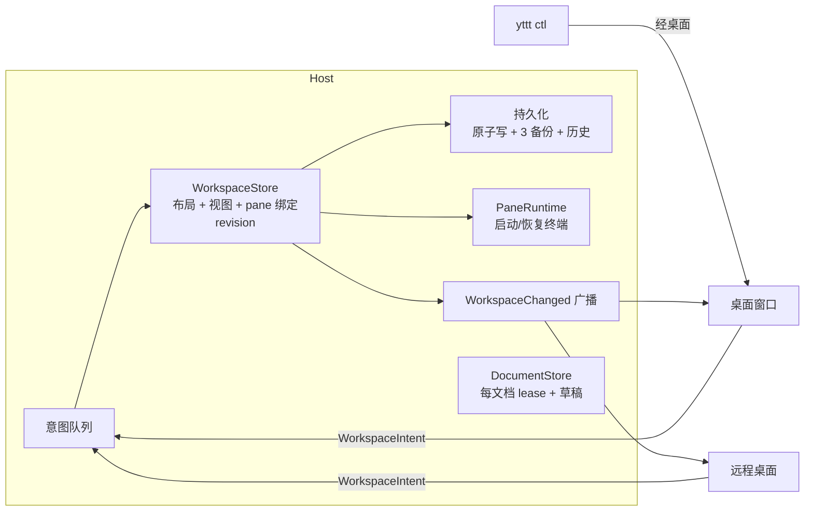

# C4 设计：布局归 Host

- 日期：2026-10-28
- 依据：[`2026-10-28-cs-convergence-plan.md`](./2026-10-28-cs-convergence-plan.md) C4、[`2026-10-28-cs-convergence-analysis.md`](./2026-10-28-cs-convergence-analysis.md) §4.4
- 前置：C3 已落地（每 Client 一条 Session 连接，可靠消息全局有序）
- 已确认的取舍（2026-10-28）：多写者；焦点与选中共享（herdr 做法）；Host 自己恢复 pane；每文档一个编辑 lease；C4 完成前不发布 v22

## 1. 现状

Host 管终端，Client 管布局，Host 只把 Client 发来的整份布局当作不透明 JSON 存下来：

| 环节 | 现状 | 位置 |
|---|---|---|
| 布局模型 | `Workspace { opened_projects, navigation }`；`OpenedProject { layout: ProjectLayout, selected_tab_id, tab_states }`；`LayoutNode::{Pane, Split}`。纯 Rust，不依赖 GPUI | `crates/yttt-core/src/model/workspace.rs:23-27,1046-1112`、`layout.rs:3-208` |
| 编辑区布局 | 每项目 `WorkAreaState`（tab group + 行/列分割，条目是终端 tab 或文件）、打开文件列表、激活历史、项目面板宽度 | `src/ui/editor/workspace.rs:25-53`、`work_area.rs`（967 行） |
| 发布 | 整份 `RemoteWorkspaceSnapshot { workspace, editor, documents, agent_states }` 每 500 ms 以 CAS 提交 `WorkspaceRequest::Commit { expected_revision, operation_id, snapshot, drafts }` | `src/ui/workbench/persistence.rs:164-170,2662-2804` |
| Host 存储 | `WorkspaceSnapshot(serde_json::Value)` 不解析 tab/pane；只校验大小、引用与摘要；记录 schema 3 | `crates/yttt-protocol/src/workspace.rs:82-120`、`crates/yttt-host/src/workspace.rs:24-89` |
| 单写入者 | 所有 mutation 必须带 `ControlContext { host_epoch, control_epoch }`，`admit_mutation` 校验当前 owner | `crates/yttt-host/src/lib.rs:1972-2010`、`crates/yttt-host/src/control.rs`（472 行） |
| 控制交接 | `ProfileControlRequest::{RequestControl, Ready, Cancel, ConfirmForce, Release, ReacquireIfUnowned}`，`TransferPhase::{Preparing, ForceConfirmationRequired, Fencing}`，5 s 准备期；多窗口经 `SessionCoordinator` 汇总各窗口发布 revision | `crates/yttt-protocol/src/session.rs`、`src/session_coordinator.rs`（334 行） |
| 恢复 | ControlLost 冻结；Device recovery 副本携带快照与正文；Host 重启后控制 Client 按 catalog 对账（`reconcile_host_resources`），把缺失的运行 pane 标为 `Restoring` 并自己重建 shell / resume Agent | `persistence.rs:291-349`、`workspace.rs:123-159`、`src/ui/workbench/surface.rs:1700-1950` |
| pane↔终端 | 约定 `TerminalSessionId = "{project}:{tab}:{pane}"`；Host catalog 只有 `project_id`，不知道 tab/pane | `src/ui/terminal/pane.rs:716-721`、`crates/yttt-protocol/src/control.rs:497-522` |

`persistence.rs` 5,101 行中大部分、`session_coordinator.rs`、Host `control.rs` 及相关 UI 都只为"布局在 Client、Host 只存快照"存在。2026-08 起的 C/S 修复中"恢复 / 生命周期"与"控制权交接 / 工作区发布"两类共 13 个提交、约 1.3 万行（分析文档 §2）。

## 2. 目标形态

### 2.1 Host 持有的 workspace 模型

- 布局类型从 desktop 下沉到 `yttt-core`：`WorkspaceState`、`ProjectLayout`/`LayoutNode`/`PaneConfig` 已在其中；`WorkAreaSnapshot`、`DocumentId`、`WorkItemId` 从 `src/ui/editor/` 移入 `yttt-core::model`，GPUI 侧只保留运行时 `WorkAreaState` 与渲染。
- 新的 Host 类型 `HostWorkspace`（wire 上的 `WorkspaceLayout`）：

| 字段 | 内容 |
|---|---|
| `revision` | 每个被接受的意图 +1 |
| `projects` | `OpenedProject`（layout 树、tab 状态、pane 状态）＋ 每项目 work area（group、split、条目、打开的文件） |
| `view` | 共享视图：选中项目、各项目选中 tab、各 tab 聚焦 pane、各 group 活动条目、项目面板可见/宽度 |
| `bindings` | pane → `TerminalSessionId` 与 session epoch；`TerminalSessionId` 仍按 `"{project}:{tab}:{pane}"` 生成 |
| `agent_states` | 每 pane 的 `AgentStateRef`（不可变对象存储不变） |

- 共享视图是 Host 事实：一个 Client 切 tab/聚焦，看同一 workspace 的其他 Client 跟着切。只留在 Client 的：编辑器光标/选区、滚动位置、主题、窗口尺寸、GPUI 运行时句柄。
- 一个桌面窗口仍对应一个 `WorkspaceId`；窗口打开/关闭即 workspace 的 `restore_on_startup` 成员资格，由 Host 决定，`SessionCoordinator` 的发布汇总删除。

### 2.2 意图 API

新增 `Request::Workspace(WorkspaceRequest::Apply { workspace_id, intent, expected_revision: Option<u64> })`，响应 `Applied { revision }`。意图（初版集合，按现有 UI 入口一一对应）：

| 类别 | 意图 |
|---|---|
| 项目 | `OpenProject`、`CloseProject { confirmed_running }`、`SelectProject`、`MoveProject` |
| tab | `CreateTab { project, config, select }`、`CloseTab`、`RenameTab`、`MoveTab`、`SelectTab`、`StartTab`（lazy→started） |
| pane | `SplitPane { target, direction, pane }`、`ClosePane`、`FocusPane`、`FocusAdjacent`、`ResizeSplit { pane, direction, ratio }`、`RenamePane`、`SetPaneExitBehavior` |
| 编辑区 | `OpenFile`、`CloseItem`、`MoveItem { to_group, placement }`、`SplitGroup`、`ActivateItem`、`SetProjectPanel { visible, width }` |
| 整体 | `ReplaceProjectLayout { project, layout }`（布局编辑器应用、历史恢复；**必须**带 `expected_revision`） |

规则：

1. Host 在一个 workspace actor 内按到达顺序执行；意图引用稳定 ID，目标不存在返回 `NotFound`，不做猜测。除 `ReplaceProjectLayout` 外不要求 CAS（herdr 同样按到达顺序，`src/api/schema/panes.rs:18-217`）。
2. 执行逻辑复用 `Workspace` 已有方法（`split_pane_node`、`remove_pane_node`、`resize_pane_split`、`adjacent_pane_id` 等，`workspace.rs:1366-1510`），不在 Host 另写一套。
3. 关 pane/tab/项目的意图在同一步内终止对应终端（Host 已有 `TerminateTerminal`/`TerminateMany`），Client 不再单独发终止请求。
4. 拖动分割线：Client 本地预览，松开时发一次 `ResizeSplit`；不做逐帧意图。
5. 不做本地乐观更新：UI 以 Host 广播为准。本机往返为毫秒级；远程链路的延迟只影响布局操作，不影响终端输入（C3 交互优先级）。

### 2.3 广播与重同步

- 每次接受意图后，Host 向所有打开该 workspace 的 Session 连接发 `ServerEvent::WorkspaceChanged { workspace_id, revision, layout }`（完整布局，不做 delta；布局规模为 KB 级，上限沿用 16 MiB）。走 C3 可靠队列，因此与随后的 `TerminalExit` 等事件保持因果顺序。
- 同一连接上未发出的旧 revision 被新 revision 取代（每连接每 workspace 一个"最新布局"槽，与渲染槽同样不入可靠队列计数），慢 Client 只收最新一份。
- `Open { workspace_id }` 返回当前 `layout` 与 `revision` 并订阅；重连后重新 `Open`，以完整布局替换本地镜像。Client 丢弃 `revision` 不大于已持有值的事件。不需要事件环或 `events_lost`：每次都是完整状态。

### 2.4 Host 恢复 pane

Host 启动（或 workspace 首次打开）时，对每个绑定的 pane：

| pane 状态 | 行为 |
|---|---|
| 曾在运行、终端已不在 | 用 pane 配置在项目根目录启动干净 shell；Agent pane 有已保存会话时用 provider `resume_command` 恢复 |
| `Exited` 且有 Agent 会话 | 同上，按 Agent resume |
| lazy 且从未启动、普通已退出 | 不启动 |

需要下沉到 Host 可用的 crate（新模块 `yttt-agent-runtime::launch` 或 `yttt-host::pane_launch`）：

- 当前 `TerminalPane::host_spawn_spec`/`remote_terminal_execution`/`command_args`/`spawn_environment`（`src/ui/terminal/pane.rs:691-809`）。
- `AgentPaneLaunch` 的构建与 provider resume（`src/runtime/agent_manager.rs:67-140`，815 行；`crates/yttt-agent-providers/src/command.rs` 的 `resume_command` 已在 Host 依赖内）。
- 输入：shell 与 scrollback 来自 Host 已权威持有的共享配置；项目环境；几何取 pane 上次几何，缺省 120×40，首个附加 Client 再 resize；查询调色板由首个 Interactive 附加按现有 `palette_revision` 更新。

Client 只附加。`Restoring` 状态、`reconcile_host_resources` 与桌面侧的自动重建删除。新建 pane 也由 Host 启动：`SplitPane`/`CreateTab`（eager）在同一步内 spawn，`StartTab` 启动 lazy tab；`SpawnTerminal` 请求保留给不进入布局的临时终端（如有），否则删除。

### 2.5 文档编辑 lease 与草稿

- `DocumentStore` 按 `(workspace_id, DocumentId)` 记录：`lease { holder: ClientInstanceId, epoch }`、草稿 `{ revision, base: DraftBase, content_sha256, bytes }`、持有者最近的选区快照。正文沿用 `drafts/<workspace>` 的 SHA-256 对象存储与 6 MiB / 64 MiB 上限。
- 请求：`AcquireDocument { document, takeover: bool }` → `Granted { epoch, draft }` 或 `Held { holder }`；`PutDocumentDraft { document, epoch, base, content }`（持有者防抖 500 ms 上传）；`ReleaseDocument`；`DiscardDocumentDraft`（保存到磁盘或撤销全部修改后）。
- 事件：`DocumentLeaseChanged`、`DocumentDraftChanged { document, revision }`。非持有者只读打开，收到变更后按需 `GetDocumentDraft`；可显式接管（与终端 Interactive lease 一致），旧持有者收到撤销后转为只读。
- lease 绑定认证会话：断线不释放，随会话的闲置保留期（5 分钟）到期或被接管才释放，因此短暂重连后可继续编辑。
- 被接管或 lease 过期时，本地尚未上传的修改写入设备草稿副本（只含这一份文档），编辑器提示"另存为 / 丢弃"。这是 Device recovery 唯一保留的部分。

### 2.6 多写者与权限

- 删除 profile 级单写入者：`ControlContext`、`ProfileControlRequest`、`ControlStatus`/`ControlTransfer`/`TransferPhase`、`ClientRequest.control`、`ControlMessage::TerminalInput.control`、`admit_mutation` 中的 control 校验与 `mutation_gate` 的交接栅栏。
- 每类共享状态各有自己的 Host 侧串行点，不再需要全局 owner：

| 状态 | 串行/互斥机制 |
|---|---|
| 布局、视图 | workspace actor 按序执行意图 |
| 终端输入/尺寸 | 每终端 Interactive lease（不变） |
| 文档草稿 | 每文档编辑 lease |
| 共享配置、项目配置 | 已有内容 revision CAS（不变） |
| 磁盘文件写入 | 已有 `ProjectFileFingerprint` 校验（不变） |

- 入口权限 `authorize_ingress`（TLS/SSH 能力）不变；"观察者"不再是整个 Client 的模式，只剩终端 Observer 附加与文档只读。

### 2.7 持久化

- Host 每个 workspace 一份 schema 4 记录：`HostWorkspace` 全量 + 草稿/Agent 引用。接受意图后 250 ms 防抖原子写；写前保留最多 3 份备份；另每 15 分钟一份历史，最多 48 份（herdr `src/persist/writer.rs:61-163`）。读取失败时先备份原文件再从最新备份恢复。
- 迁移：schema 3 记录（`snapshot` 内含 `RemoteWorkspaceSnapshot` schema 2 JSON）由 Host 一次性解析为 `HostWorkspace`，`documents[].draft_ref` 转为 `DocumentStore` 草稿（无 lease）；原文件改名保留为 `*.schema3.json`，迁移失败不覆盖。

### 2.8 CLI

`yttt ctl` 仍经桌面 socket；桌面把布局类命令转成意图发往 Host，不再自己修改模型。直接连 Host 的 CLI 不在本阶段。

## 3. 实施顺序

全部在 v22 内完成后再发布；每步结束时测试全绿、可提交。

| 步 | 内容 | 完成判据 |
|---|---|---|
| C4-1 | 模型下沉：`WorkAreaSnapshot`/`DocumentId`/`WorkItemId` 移入 `yttt-core`；定义 `HostWorkspace`、意图枚举与执行器（纯函数，含单元测试）；schema 3→4 迁移函数 | 执行器对每个意图的单元测试；用现有 schema 2 样本迁移往返 |
| C4-2 | Host `WorkspaceStore`：actor、`Apply`/`Open`、`WorkspaceChanged` 广播与每连接最新布局槽、持久化与备份；关闭类意图终止终端 | 两个 Client 并发意图收敛到同一 revision；慢 Client 只收最新；Host 重启后布局恢复 |
| C4-3 | 桌面改为镜像：`Workspace`/work area 从 Host 布局构建，所有 UI 入口发意图；删除 500 ms 发布管线、`Commit`、`SessionCoordinator` 发布汇总、`RemoteWorkspaceSnapshot` | `persistence.rs` 中发布/CAS/恢复候选代码删除；`ui_state` 等 UI 测试改为经意图 |
| C4-4 | pane 启动下沉：spawn spec 与 Agent launch/resume 移入 Host 可用 crate；Host 在意图内启动、启动时恢复 | Host 重启后无 Client 连接即恢复 shell/Agent；桌面无 `Restoring` 重建代码 |
| C4-5 | `DocumentStore`：lease、草稿、接管、设备副本 | 双 Client 同文档：一方编辑另一方只读并看到草稿；接管后旧方未上传修改进入设备副本 |
| C4-6 | 删除单写入者：`ControlContext` 等协议类型、Host `control.rs`、`admit_mutation` 控制校验、ControlLost/交接 UI 与 Device recovery 中布局部分；重写 `wire-shapes-v22.json` | 删除清单符号全无残留 |
| C4-7 | 文档、探针、冒烟 | 见 §5 |

## 4. 删除清单（完成标志）

| 侧 | 删除 |
|---|---|
| 协议 | `WorkspaceSnapshot`（不透明 JSON）、`WorkspaceRequest::{Commit, PutDraft, GetDraft}`、`WorkspaceResponse::{Committed, Draft, DraftStored}`、`WorkspaceOperationId`、`validate_workspace_manifest`；`session.rs` 全部控制类型；`ClientRequest.control`；`ControlMessage::TerminalInput.control`；`Request`/`Response`/`ServerEvent` 的 `ProfileControl` 变体 |
| Host | `control.rs`；`admit_mutation` 的控制校验与交接 `mutation_gate` 写锁；workspace 幂等操作记录（`MAX_COMPLETED_OPERATIONS`） |
| 桌面 | `SessionCoordinator` 的发布/交接汇总；`persistence.rs` 的发布管线（`PendingWorkspaceCommit`、`last_committed_snapshot`、`control_request_in_flight`、`commit_in_flight`、`recovery_candidate`、`WorkspaceRecoveryChoice`、`RecoverableWorkspaceDraft` 的布局部分）；ControlLost 冻结、交接对话框与强制确认、"恢复完整工作区"入口；`Workspace::reconcile_host_resources` 与 `Restoring` 自动重建 |
| ClientCore | 控制状态握手（`establish` 中的 `ProfileControl` 查询）、`ReacquireIfUnowned` 恢复、`recovery_tests.rs` 中控制相关用例 |

## 5. 验收

- 行为测试（真实 Host）：
  - 两个 Client 同时发意图（split/close/focus 交错）：二者最终布局与 revision 相同；共享焦点随对方切换。
  - 关闭 pane 的意图之后到达的事件中，该终端的 `TerminalExit` 不早于 `WorkspaceChanged`。
  - Host 重启：无 Client 时 Host 已按布局恢复 shell 与可 resume 的 Agent；随后附加的 Client 看到运行中的终端，不出现 `Restoring`。
  - 文档 lease：独占、接管、断线保留、闲置过期；被接管方未上传修改进入设备副本。
  - 慢 Client：停止读取期间其他 Client 的意图照常执行；恢复后收到最新一份布局。
  - 迁移：schema 3 样本（含草稿与 Agent 引用）迁移后布局、草稿、Agent 状态一致，原文件保留。
- 桌面冒烟：与 C2/C3 相同的 `yttt ctl` 场景；另起一个远程 Client（`--remote` 本机 TLS）与桌面同看一个 workspace，互相可见对方的分割与 tab 切换；杀 Host 后 launcher 拉起，终端在桌面重新附加前已运行。
- 删除清单符号在 `crates/`、`src/`、`tests/` 中无残留。
- 文档：`host-client-architecture.md`（不变量 2/11/12、§6、§6.1、§10）、`wire-evolution.md`、`CHANGELOG.md`、计划进度。

## 6. 非目标

- CLI 直连 Host、Host 侧意图之外的自动化 API（herdr 的 `events.wait` 类能力）。
- 多人协同编辑同一文档（CRDT/OT）；文档以 lease 互斥。
- 布局 delta 编码；完整布局足够小。
- 升级时保活进程（handoff）。

## 7. 风险

| 风险 | 处理 |
|---|---|
| 改动面最大（`persistence.rs`、`workbench/mod.rs`、`surface.rs`、`pane.rs`） | 按 §3 分步，每步测试全绿再进下一步；C4-3 前桌面仍走旧发布路径 |
| 共享焦点在两个 Client 同看一个 workspace 时互相打扰 | 已确认采用；本机多窗口各看自己的 workspace，不受影响 |
| Host 恢复需要的 spawn 输入（shell、环境、Agent hook 环境）目前分散在桌面 | C4-4 先把这些移入 crate 并加单元测试，再切换调用方 |
| 意图集合覆盖不全导致某些 UI 入口无法表达 | C4-3 中逐个替换 `Workspace` 的 `&mut` 调用点；编译器保证无遗漏（桌面不再持有可变布局） |
