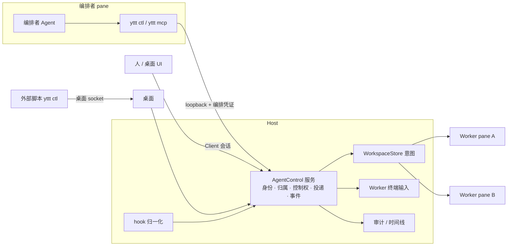

# Agent 编排与人机交接计划

> **For agentic workers:** REQUIRED: 遵循仓库 `AGENTS.md`。在当前会话内按顺序执行本计划，不要把计划执行委托给 subagent。每项先写能复现缺失行为的测试，再做最小实现；只有验收条件实际通过后才能勾选。

**状态：** P0、P1、P2 已实现（见 §6 记录；推迟项在各条目中注明）；下一步 P3。§4 的开放问题已于 2026-11-05 按建议默认确认。

**依据：** 2026-11-05 对 `yttt ctl`、Agent hook、调度中心与 C4 之后 Host 布局的代码梳理；`docs/cli-control.md`、`docs/host-client-architecture.md`、`docs/plans/2026-10-28-c4-host-owned-layout-design.md`。同类设计参考：Claude Code agent teams（lead + teammate，各占一个 pane，人可直接进入 teammate）、Codex app-server（`turn/start`、`turn/interrupt`、`turn/completed{status}`）、ACP（`session/prompt`、`session/cancel`、`session/update`）、cmux（终端 socket/CLI + hook 通知）。

**目标：** 在 yttt 里由一个"编排者"Agent 会话驱动其他 Agent：创建、发送、打断、等待、取结果、监听状态。所有 Worker 都是真实终端 pane，人始终能看到并随时接管；接管与交还是显式状态，编排者能感知；每次控制操作都可追溯到发起身份。

**非目标：** 不替换 PTY 交互为 provider 原生协议（原生协议只作为后续可选适配）；不做跨 Host 的编排；不做自动任务拆分或调度策略（属于编排者自身的提示词/skill）；不改变终端 Interactive lease 对人类输入的语义。

---

## 1. 现状

| 能力 | 已有 | 位置 | 缺口 |
|---|---|---|---|
| pane 身份 | 每个终端启动时签发 `AgentHookScope { project_id, tab_id, pane_id, generation }`，HMAC token，清除继承的伪造变量 | `crates/yttt-host/src/agent_hooks.rs:248`、`:1973`；`pane_runtime.rs:336` | 只用于 hook 上报；进程拿不到可读的"我是谁"；token 被子进程继承，不能直接升格为控制凭证 |
| 状态 | 统一事件 `TurnStarted / ActionStarted / Waiting{Approval,UserInput,External} / TurnFinished{outcome} / Child*` | `crates/yttt-agent-core/src/event.rs`；映射 `crates/yttt-agent-providers/src/command.rs:179` | 只有快照，没有带游标的事件流，没有阻塞等待 |
| 结果 | `AgentBoardMessage{role, text}`；会话元数据记录 `transcript_path` | `board.rs:103`；`command.rs:259` | 只有 OMP 产生 Message（`omp.rs:539`），Claude/Codex 等没有最终回复 |
| 发送 | `ctl panes/agents send` 经桌面以粘贴编码写 PTY | `src/ui/workbench/desktop_control.rs`；`src/ui/terminal/pane.rs:361` | 无投递 ID，无法关联到 turn；输入不区分来源；会把人未提交的草稿一起提交 |
| 打断 | 识别 `Stop{is_interrupt}` 为 Interrupted | `command.rs:204` | 无打断命令 |
| 布局 | Host 持有布局，`WorkspaceRequest::Apply` 意图不要求控制权；Host 自行启动 pane 进程 | C4-2/C4-4；`crates/yttt-host/src/pane_runtime.rs` | ctl 仍只经桌面 socket 进入；Host 侧没有面向 Agent 的控制入口 |
| 审计 | Host 有有界审计日志（`actor_client_id`、action、resource） | `crates/yttt-host/src/audit.rs` | 无 Agent 身份；不可查询；调度中心无时间线 |
| 寻址 | ctl 以 project/tab/pane 三元组寻址 | `src/cli.rs` | 编排者需要稳定的 Worker 句柄 |

`docs/cli-control.md` 中"观察端不能修改、CLI 不取得控制权"的描述早于 C4-6 删除单写者，P4 一并更正。

## 2. 目标形态



### 2.1 关键决定

| # | 决定 | 理由 |
|---|---|---|
| K1 | 编排服务放在 Host（新模块 `agent_control`），桌面 socket 与 Agent loopback 入口都转到它 | Host 已是终端、Agent 状态与布局的权威；Agent 进程总运行在 Host 机器上，远程 Host 无需额外转发 |
| K2 | 身份 `Principal = Human(client session) / Agent(scope) / External(本机 socket)`，由入口与凭证决定，不接受自报 | `host-client-architecture.md` 原则 13：入口来源由 listener 指定 |
| K3 | 编排凭证 `YTTT_AGENT_CONTROL_TOKEN` 与 hook token 分开，只签发给人明确授予"编排者"角色的 pane | hook token 被 pane 内所有子进程继承；若直接用作控制凭证，任意脚本都能操控其他 Agent |
| K3a | K3/K5 是防止 Agent 误操作的护栏，不是对抗同 UID 恶意进程的安全边界：同 UID 进程仍可经桌面 socket 以 External 身份调用 ctl | 与现有本机管理入口的信任模型一致；P1 起桌面 socket 路径也携带 pane 自报身份，按 Agent 规则约束 |
| K4 | Worker 句柄 = 其 pane 的 `TerminalSessionId`，请求携带 `generation` 防止误操作替换后的进程 | CLI 创建的 tab/pane 已用 UUID，跨重启稳定 |
| K5 | 默认权限：编排者只能操作自己创建或人分配给它的 Worker；不能回答 `Approval`；不能关闭非自有 pane；不能嵌套创建编排者 | 防止编排者绕过人对 Worker 的审批 |
| K6 | 控制权 `controller = auto | human | paused` 存在 Host，随 pane 状态持久化；Host 看到 Client 键盘输入写入 Worker 即切到 `human` | Host 能看到所有 Client 的输入，判定集中且跨窗口一致 |
| K7 | 编排者输入由 Host 直接写 PTY，按 K5/K6 与 turn 状态准入，不经 Client Interactive lease | lease 管的是"哪个人类 Client 打字"；编排输入是另一类主体 |
| K8 | 投递 → turn 关联：下一个 `UserPromptSubmit` 的规范化文本哈希匹配则绑定 `turn_seq`；无 prompt 字段的 provider 降级为 `unconfirmed` | 区分"Host 收到字节"和"Agent 开始处理这条消息" |
| K9 | 结果在 `TurnFinished` 时统一产生 `Message{Assistant}`：hook payload 字段 → transcript 尾部解析 → 视口兜底（标注来源） | 一个结果接口覆盖所有 provider |
| K10 | 协议只追加；新字段 `#[serde(default)]`；按 `docs/wire-evolution.md` 记录 | 与链路韧性计划相同约束 |

### 2.2 命令面（最终形态）

```sh
yttt ctl whoami --json
yttt ctl agents spawn --provider codex [--title T] [--placement tab|split] [--worktree NAME] -- ARGS
yttt ctl agents send --agent W (--text T | --prompt-file F | --stdin) [--queue]
yttt ctl agents wait --agent W [--agent W2 ...] --until turn_finished|waiting|idle|control_changed|any --timeout 300
yttt ctl agents result --agent W [--turn N] --json
yttt ctl agents interrupt --agent W [--terminate-after 10]
yttt ctl agents release --agent W        # 编排者主动交给人
yttt ctl agents list --mine --json       # 精简视图：句柄、状态、控制权、最近一轮
yttt ctl events --follow [--since CURSOR] [--mine]
```

`--agent` 沿用现有只接受 `--key value` 的解析方式。没有编排凭证时，这些命令以 Human/External 身份经桌面 socket 执行，同样受 K6 控制权约束。

### 2.3 状态机

控制权：

```
auto ──Client 键盘输入 / 人点「接管」──▶ human ──人点「交还」──▶ auto
auto ──编排者 release──▶ human
任意 ──人点「暂停」──▶ paused ──人点「恢复」──▶ 之前状态
```

投递：

```
queued ──(controller=auto 且 turn 就绪 且 上轮结束后无人类输入)──▶ written
written ──匹配的 UserPromptSubmit──▶ started(turn_seq) ──TurnFinished──▶ finished(outcome)
written ──超时 / 无法匹配──▶ unconfirmed
queued ──人撤回 / Worker 退出──▶ cancelled
```

`human` 或 `paused` 时编排者的 `send` 返回 `human_control` / `paused`，`--queue` 的消息保持排队；`wait` 收到 `control_changed` 事件立即返回。

---

## 执行约束

- [ ] P0 → P1 → P2 → P3 → P4 顺序执行；每阶段单独提交，阶段内每项先有失败的测试。
- [ ] 不改变 Host 资源所有权、终端 Interactive lease 与本机 IPC/TLS/SSH 入口的认证检查。
- [ ] 所有新增队列、事件缓冲、结果文本都有硬上限（事件环 4096 条/Agent，结果 64 KiB，排队消息 32 条/Worker）。
- [ ] 请求保持 at-most-once：有副作用的命令带 `generation` 与幂等键，超时返回 `outcome_unknown`，不自动重放。
- [ ] 每阶段结束同步 `docs/cli-control.md`、`docs/host-client-architecture.md` 对应章节和 `README*.md` 中的 ctl 介绍。
- [ ] 每阶段做一次真实桌面冒烟（隔离 `YTTT_PROFILE_ROOT`），记录命令与观察结果；GUI 内无法自动化的步骤写明手工验证。

---

# P0：身份与编排凭证

**问题：** 进程不知道自己是谁；控制请求没有可信的发起者；hook token 不适合作为控制凭证。

**主要区域：** `crates/yttt-host/src/agent_hooks.rs`、新增 `crates/yttt-host/src/agent_control.rs`、`crates/yttt-protocol/src/desktop_control.rs`、`src/cli.rs`、`crates/yttt-host/src/audit.rs`。

## P0-1：注入只读身份

- [x] 测试：新启动的 pane 环境含 `YTTT_SELF`（project、session、generation 的编码），重启 pane 后 generation 递增；继承的同名变量被替换。
- [x] 实现：在 `secure_terminal_environment` 中一并写入，复用伪造变量清理列表。
- [x] 验收：`yttt ctl whoami --json` 在任意 pane 中输出自身句柄；在 pane 外报告 `external`。

## P0-2：编排角色与凭证

- [x] 测试：未授予角色的 pane 没有 `YTTT_AGENT_CONTROL_TOKEN`；授予后重启 pane 才获得；用 A 的 token 带 B 的 scope 被拒；generation 过期被拒；hook token 调用控制入口被拒。
- [x] 实现：pane 状态新增 `role: worker | orchestrator`（默认 worker，随 Host 布局持久化）；Host 用独立密钥派生控制 token；角色只能由 Human 主体设置（`agents create --role orchestrator` 仅经桌面 socket 可用；pane 菜单开关随 P3-4）。
- [x] 验收：真实冒烟中，worker pane 里调用 `agents spawn` 得 `forbidden`。

## P0-3：Host 控制入口与路由

- [ ] 测试：loopback 入口只接受带有效控制 token 的请求；请求主体从 token 派生，自报字段被忽略；桌面 socket 转发的请求主体为 Human/External。（已完成前两条；桌面 socket 路径仍按 External 执行、不携带 pane 身份，推迟到 P2 与 send/interrupt 一起处理）
- [ ] 实现（`/control/v1`、whoami 与 Host `AgentControl` 已完成；桌面 socket 路径并入同一入口推迟到 P2）：在 hook HTTP listener 上增加 `/control/v1` 路径（理由：SSH 托管项目已为该 endpoint 建立反向转发，控制入口随之可达）；`yttt ctl` 检测到控制 token 时直连 Host，否则保持桌面 socket；两条路径进入同一 `AgentControl::handle(principal, request)`。
- [ ] 验证项：SSH 托管项目的 Agent 进程运行在远端，确认 hook 回报的现有转发方式，控制入口沿用同一方式；不可达时 `whoami` 明确报告 `control_unavailable`。
- [ ] 验收：同一命令从编排者 pane 与 pane 外执行，审计记录的主体不同。

## P0-4：审计带主体（并入 P1：P0 只有只读的 `whoami`）

- [ ] 测试：每个控制请求（含被拒绝的）写一条审计，含 principal、目标句柄、命令、结果、delivery/turn ID。（P1：`AgentControl` 对 spawn/list/close 记录 `agent:<terminal>`、动作、目标与 Allowed/Denied，尚无自动化测试；delivery/turn 随 P2）
- [ ] 实现：扩展 `AuditEntry`；新增按 Worker/编排者查询的有界接口。（查询接口随 P3-4 时间线）

---

# P1：创建与归属

**问题：** 编排者无法以稳定句柄创建 Worker；没有父子关系与权限边界。

**主要区域：** `agent_control.rs`、`crates/yttt-core` 中 `host_workspace` 意图、`pane_runtime.rs`、`src/ui/workbench/desktop_control.rs`。

## P1-1：`agents spawn`

- [x] 测试：编排者 spawn 返回 Worker 句柄（`ControlledAgent`）；Worker 记录 `spawned_by` = 编排者终端并随布局持久化，Host 重启后保留（真实冒烟验证）；放在编排者所在项目的新 tab。
- [x] 实现：Host 内用现有 `WorkspaceIntent::CreateTab` 创建 Agent tab，由 `pane_runtime::ensure` 启动。
- [ ] 推迟：响应中的 generation 与初始 prompt 的投递记录随 P2；`--placement split` 需要 Agent 版拆分意图，随 P2；`--worktree NAME` 随 P4。

## P1-2：权限检查

- [x] 测试：编排者对非自有 pane 执行 close 得 `forbidden`；人通过 `agents assign --project --tab --pane --to TERMINAL`（经桌面，`SetPaneOwner` 意图）分配后允许，`--clear` 收回；句柄不存在得 `not_found`；角色被移除的 pane 即使持有凭证也得 `forbidden`。send/interrupt/read 随 P2 用同一检查。
- [x] 实现：`owned_worker` / `caller_pane` 作为单一检查入口；Human/External 经桌面 socket，不受归属限制。

## P1-3：精简列表

- [x] 测试：`agents list --mine` 每个 Worker 一行：句柄、标题、终端状态、Agent 的 provider/process/turn/等待原因/任务；不含 board 历史。controller 随 P3，turn_seq 与 outcome 随 P2。

---

# P2：投递、等待、结果、打断

**问题：** 编排闭环的四个原语缺失或不可靠。

**主要区域：** `agent_control.rs`、`crates/yttt-agent-core/src/reducer.rs`、`crates/yttt-agent-providers/src/command.rs` 与各 provider 适配、`crates/yttt-host/src/terminal.rs`。

## P2-1：turn 序号与事件流

- [x] 测试：reducer 在每次 `TurnStarted` 递增 `turn_seq`，`TurnFinished` 不改变它，恢复时保留；旧快照缺字段读作 0。
- [ ] 推迟到 P3：带游标的事件环与 `events --follow`。P2 的 `wait` 直接轮询 pane 内的 Agent 快照（200 ms），足以闭环；事件流在 P3 需要 `control_changed` 时一起做。

## P2-2：`agents wait`

- [x] 测试：Worker 完成编号大于 `after_turn` 的一轮时返回 `matched`（之前已完成的轮不算）；超时返回当前状态而非错误；Worker 进程或 pane 结束返回 `exited`；无权 Worker、超过 600 s 被拒；`change` 只对等待开始后的变化生效。`wait` 与 `interrupt` 在 hook listener 上各占独立线程（上限 32），去掉该分支后"阻塞请求不占用 hook worker"测试失败。
- [x] 实现：`--agent A,B`（最多 16 个）、`--until finished|waiting|ready|change`、`--after-turn N`、`--timeout`（默认 300，上限 600）。`control_changed` 随 P3。

## P2-3：投递与关联

- [x] 实现：Host 侧直接写 PTY（K7），按终端当前 bracketed-paste 模式编码，末尾加 Enter；只在 Agent 报告 running 且 idle/completed/failed/interrupted 时接受，否则 `not_ready`；返回 `turn_seq_before`，配合 `wait --after-turn` 关联本次输入引起的轮次。
- [ ] 推迟：按 `UserPromptSubmit` 文本哈希的精确关联（`after_turn` 已足够闭环，精确关联在人机混用时才有区别，随 P3）；`human_input_pending` 随 P3-1 输入来源；`--queue` 随 P3-2。

## P2-4：结果统一

- [x] 测试：Claude transcript 取最近一次人类 prompt 之后助手写下的最后一个文本块（跳过 thinking、tool_use、tool_result）；Codex 优先 `task_complete.last_agent_message`，旧版本退回助手 `output_text`，新任务开始后清空；未知 provider、文件缺失、尾部截断行均不误报；结果超过 64 KiB 截断并标 `truncated`。
- [x] 实现：`agents result --agent` 从快照中的 `transcript_path` 读取文件末尾 8 MiB，返回 `{turn_seq, turn, text, truncated, source}`；读不到时 `source: unavailable`。
- [ ] 推迟：视口兜底、按 `--turn N` 取历史轮次、SSH 项目（transcript 在远端，当前为 `unavailable`）；provider 支持表随 P4-3 文档。

## P2-5：打断

- [x] 实现：claude、codex 写入 Esc，其余 provider 返回 `invalid_request`（不盲发未知按键）；Agent 不在轮次中返回 `not_ready`；期限内轮次结束得 `confirmed: true`，否则 `false`，Worker 保持不动。
- [ ] 推迟：`--terminate-after`；用真实 Claude/Codex 记录验证过的版本（本阶段冒烟用模拟 provider，见 §6）。

---

# P3：控制权与人机交接

**问题：** 编排者与人共用同一终端时会互相覆盖输入，编排者不知道人已介入。

**主要区域：** `crates/yttt-protocol`（`TerminalInput` 来源字段）、`crates/yttt-host/src/lib.rs` 输入准入、`agent_control.rs`、调度中心 UI。

## P3-1：输入来源

- [ ] 测试：`TerminalInput` 新增 `origin: keyboard | control`（默认 keyboard，旧 Client 兼容）；桌面 ctl 路径写 `control`；Host 记录每个终端最近一次 keyboard 输入时间。

## P3-2：自动接管与交还

- [ ] 测试：`auto` 的 Worker 收到 keyboard 输入后变为 `human` 并发出 `control_changed{by: human}`；`human` 状态下编排者 send/interrupt 得 `human_control`，排队消息不写出；人点「交还」后排队消息按序写出；`release` 由编排者发起后同样进入 `human`。
- [ ] 实现：控制权状态存 Host pane 状态；任一窗口的操作对所有 Client 一致。

## P3-3：审批与提问交给人

- [ ] 测试：Worker 进入 `Waiting{Approval}` 时编排者的 `panes send`/`board answer` 被拒，Host 发出 `needs_human` 事件并触发现有通知；`Waiting{UserInput}` 的结构化问题按 §4 Q2 的决定处理。

## P3-4：调度中心呈现

- [ ] 编排者节点下列出 Worker：控制权标记、当前 turn、排队消息（可编辑/撤回/调序）、「接管 / 交还 / 暂停」按钮。
- [ ] 时间线：按审计与投递记录展示"主体 → Worker：动作 → 结果"。
- [ ] 测试：沿用 `command_center` 现有测试方式覆盖状态到视图的映射；按钮动作走 Host 请求。

---

# P4：工具化与文档

## P4-1：`yttt mcp`

- [ ] stdio MCP server，工具与 §2.2 一一对应，复用同一 `AgentControl` 客户端；工具描述写明前置条件与错误码。
- [ ] 测试：工具 schema 快照；在编排者 pane 内调用 `spawn → wait → result` 的集成测试。

## P4-2：编排 skill

- [ ] 提供一个编排者 skill：任务拆分格式、结果文件约定（`.yttt/runs/<delivery>/result.md`）、遇到 `human_control` / `needs_human` 时的行为、何时 `release`。

## P4-3：文档

- [ ] 更新 `docs/cli-control.md`（含 C4-6 后的控制权描述更正）、`docs/usage.md` 调度中心章节、`docs/host-client-architecture.md` 主体与入口章节、README。

---

## 3. 验收冒烟（P3 结束时）

隔离 `YTTT_PROFILE_ROOT`，本地项目：

1. 人在 pane 菜单把一个 Claude pane 设为编排者，重启该 pane。
2. 编排者执行 `agents spawn` 创建两个 Codex Worker（一个 tab、一个 split），各带初始任务。
3. 编排者 `agents wait --agent A --agent B --until turn_finished`，返回先完成者；`agents result` 取到最终回复。
4. 人在 Worker B 中键入；编排者下一次 `wait` 立即收到 `control_changed`，`send` 得 `human_control`；编排者 `--queue` 一条消息。
5. 人点「交还」；排队消息写出并在 B 的终端中可见，`result` 关联到新 turn。
6. 编排者 `interrupt` Worker A，状态变为 `interrupted`。
7. 调度中心时间线完整显示以上步骤与主体。

同样流程在 Host 托管的 SSH 项目上复跑一次（P0-3 验证项通过后）。

## 4. 开放问题（实施前确认）

| # | 问题 | 建议默认 |
|---|---|---|
| Q1 | 编排者能否接管人分配的已有 Agent，还是只能管自己创建的 | 两者都允许，分配需 Human 主体显式操作 |
| Q2 | 编排者能否回答 Worker 的 `UserInput` 结构化问题 | 允许；`Approval` 一律交给人 |
| Q3 | 人接管的判定：任意键入即接管，还是只在点击「接管」时 | 任意键入即接管（防止草稿被提交），可在设置中改为仅点击 |
| Q4 | 是否允许编排者嵌套（Worker 再当编排者） | 不允许 |
| Q5 | Worker 默认是否放进独立 worktree | 不默认；`--worktree` 显式开启 |

## 5. 风险

- **投递关联**：provider 对 prompt 的改写方式与 hook 字段随版本变化；以夹具固定已验证版本，未知情况降级为 `unconfirmed`，不误报成功。
- **hook 覆盖不全的 provider**（grok、pi 等）：状态可能长期为 Unknown，`wait`/`result` 只能降级；在文档表格中逐一标注。
- **打断按键**：同一按键在不同 provider/版本含义不同，可能清空输入而非打断；只对验证过的版本启用，其他返回 `unsupported`。
- **安全**：编排凭证泄露等同于对其 Worker 的完全控制；凭证仅在编排者 pane 内、按 generation 失效，审计可追溯。

## 6. 实施记录

| 日期 | 阶段 | 内容 |
|---|---|---|
| 2026-11-05 | P0-1～P0-3 | `yttt-protocol::agent` 集中定义 Host 注入的 5 个变量（替换 Host、pane_launch、SSH、桌面 4 处副本）与 `AgentHookScope::encode/decode`；每个终端注入 `YTTT_SELF`；`PaneConfig.role`（worker 不序列化，旧形状不变）、`NewTab::Agent.role`、`CreateAgent.role`；`pane_runtime` 按 pane 角色签发控制 token（HMAC，`control:` 域前缀与 hook token 区分），Host 记录编排者 scope，重启或角色变更即失效；hook listener 新增 `/control/v1/whoami`；`yttt ctl whoami [--json]` 与 `agents create --role`。个人布局模板不携带角色。测试：`agent_hooks` 新增 3 例（注入、凭证鉴权含重启失效、真实 HTTP 路由），`agent_control_client` 4 例，`cli_control` 与 `host_workspace` 各 1 例；CI 同款 16 个包 `cargo test` 1648 通过、0 失败，clippy `-D warnings` 与 fmt 通过（`--workspace` 下 vendor `gpui-markdown-editor` 的 lib test 在 master 上即无法编译，与本改动无关）。真实桌面冒烟（隔离 `YTTT_PROFILE_ROOT`；profile 放在 worktree `tmp/`，放 scratchpad 时路径超过 Unix socket 长度上限）：ctl 新建 shell tab，pane 内环境含 `YTTT_SELF`，`whoami --json` 返回 pane、worker、`not_granted`，中文文本输出正常；pane 外返回 `external`；provider 配置文件前后校验和一致。未做：编排者 pane 的端到端冒烟——Agent pane 启动会安装 provider hook，P1 冒烟按 AGENTS.md 记录并还原 hook 后再做；P0-2/P0-3 的两条验收依赖 P1 的 spawn 与审计。 |
| 2026-11-05 | P1 | `PaneConfig.spawned_by` 与 `NewTab::Agent.spawned_by`、`WorkspaceIntent::SetPaneOwner`；Host `agent_control`（hook listener 鉴权后经 `AgentControlHandler` 转入，进入 Host tokio 上下文执行）：`/control/v1/agents/spawn`、`/list`、`/close`，按 `spawned_by` 检查归属并写审计；关闭唯一 pane 时关闭其 tab，项目最后一个终端 tab 拒绝关闭。`WorkspaceService::locate_pane`/`panes_where`。CLI：`agents spawn`、`agents list --mine`、`agents close --agent`（编排者 pane 直连 Host，非编排者得 `forbidden`），`agents assign --to/--clear`（经桌面）。测试：`agent_control` 4 例、hook 转发 1 例、客户端 1 例、CLI 解析 2 例、`host_workspace` 1 例、桌面 `cli_control_creates_splits…` 增加 assign 断言。真实桌面冒烟（隔离 profile；临时 `HOME`，`PATH` 前置假 `claude`/`codex` 脚本以免 provider hook 写入真实配置）：编排者 `whoami` 得 `verified`；spawn 出 W1，pane 内可见假 codex 收到参数；worker pane 内 spawn 得 `forbidden`；关闭人创建的 Agent 得 `forbidden`，人 assign 后出现在 `list --mine`；重启桌面与 Host 后角色、归属保留，`whoami` 仍 `verified`，close W1 后 tab 移除、Host 子进程 4→3。真实 provider 配置校验和前后一致；hook 只写入临时 HOME，随冒烟目录删除。观察：重启后约数秒内 pane 列表为 `starting`、`panes send` 得 `not_ready`，之后恢复，与本改动无关，未深究。 |
| 2026-11-05 | P2 | `AgentSnapshot.turn_seq`；Host `/control/v1/agents/send`、`/wait`、`/result`、`/interrupt`（后两类阻塞请求在 hook listener 上各占独立线程，上限 32）；`agent_control/transcript.rs` 读取 Claude/Codex 会话记录末尾的最后回复；新错误码 `not_ready`（HTTP 409，CLI 显示为忙碌）。CLI：`agents send --agent`（不带 `--agent` 仍走桌面）、`agents wait`、`agents result`、`agents interrupt`。测试：reducer 1 例、`agent_control` 4 例、transcript 3 例、hook 线程 1 例（已确认去掉修复后失败）、CLI 解析 1 例。真实桌面冒烟（隔离 profile、临时 HOME）：用 Python 写的模拟 Claude（向真实 hook endpoint 发送 Claude 格式的 SessionStart/UserPromptSubmit/Stop，写 Claude 格式 transcript，读 bracketed paste，Esc 视为打断）作 Worker，编排者为 shell。spawn 带初始任务 → `wait` 得 `completed #1` → `result` 得 "Done: fix the parser" → `send` 返回 `turn_seq_before: 1` → `wait --after-turn 1` 得 `completed #2` → `result` 得第二轮回复；长任务进行中 `send` 得忙碌；`interrupt` 得 `confirmed: true`，状态 `interrupted #3`。Worker 终端可见全部 prompt、回复与打断。真实 provider 配置前后一致。未做：真实 Claude/Codex 的验证（需在真实 HOME 安装开发版 hook，会覆盖正式版写入的 hook 配置，需先备份并征得同意）。 |
